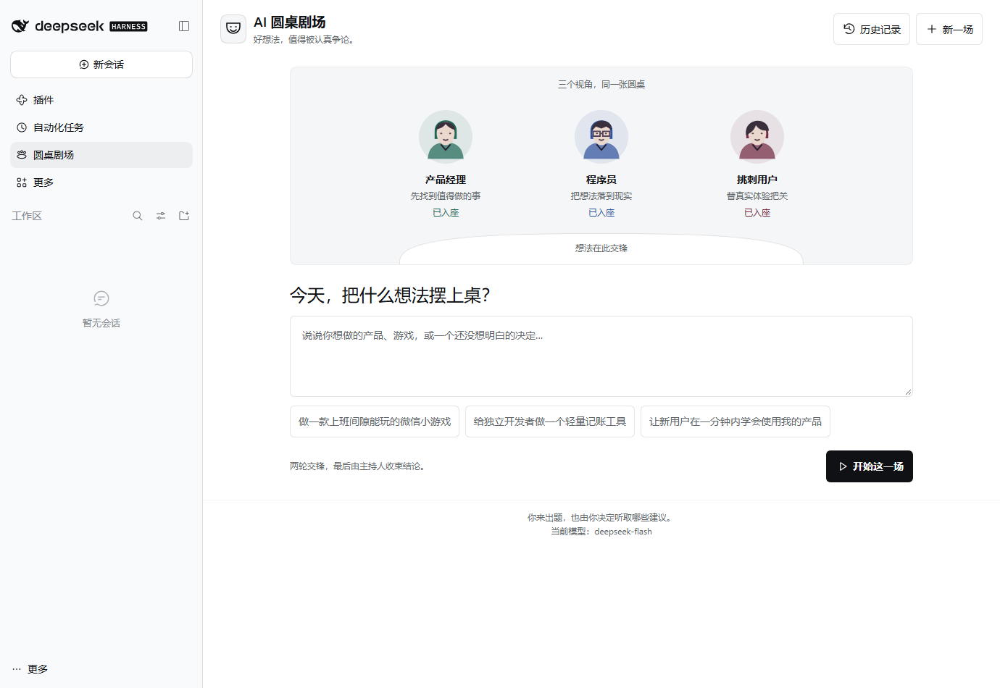
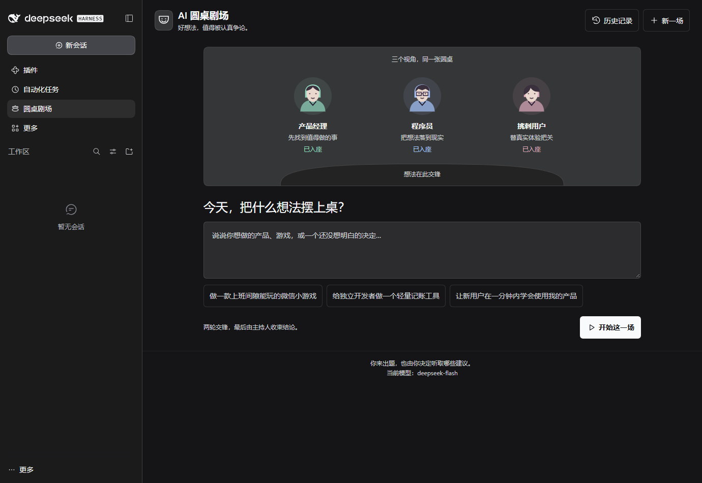

# AI 圆桌剧场

中文 | [English](README.en.md)

把一个想法摆上桌，让产品经理、程序员、挑刺用户认真争论。DeepSeek Harness 原生插件，左侧“圆桌剧场”入口打开独立面板，无需先创建聊天会话。



<details>
<summary>查看深色主题</summary>



</details>

## 已实现

- 第一轮：三个角色分别提案；第二轮：回应前面的观点、提出质疑与取舍。
- 主持人汇总共识、分歧和下一步。
- 流式发言、暂停与继续、点名追问、单条重新回答并保留旧版本。
- 对发言赞同或质疑；新追问、重答和投票后可刷新结论。
- 历史讨论自动保存、重启恢复、删除与 Markdown 导出。
- 右上角历史抽屉支持搜索和切换讨论；讨论中使用紧凑角色栏、独立阅读区和底部追问框。
- 可从发言直接追问、在生成期间先写草稿、定位和复制最新结论；回看旧发言时提示新内容。
- 三个角色的原创 SVG 头像与圆桌区域，颜色和字体跟随 Harness 主题，适配窄面板和手机宽度，支持键盘和减少动态效果。

## 安装到 Harness

最低兼容版本：**DSH 0.1.5-rc.1**，安装声明不设置版本上限，包含后续预发布版本。已验证的运行时为 **0.1.5-rc.1** 和 **0.2.1-rc.3**，运行验证覆盖原生宿主、RPC、持久化和界面入口。

推荐使用 GitHub Release 的预构建安装包：

```sh
dsh plugin --profile web add https://github.com/huazhaoyishiba/dsh-roundtable-theater/releases/latest/download/dsh-roundtable-theater.tgz
```

桌面版可在“插件”页添加上述下载链接，或下载 [Release 安装包](https://github.com/huazhaoyishiba/dsh-roundtable-theater/releases/latest) 后导入。

也可从源码仓库安装，仓库包含已构建的浏览器入口：

```sh
dsh plugin --profile web add https://github.com/huazhaoyishiba/dsh-roundtable-theater
```

本机开发目录安装到 Web profile：

```powershell
dsh plugin --profile web add D:\wxchat
```

然后重启该 profile 的 `dsh web`，在左侧打开 **圆桌剧场**。CLI 会保留原有 bundle 与配置。开发目录需要保留，因为本地安装使用目录链接。

独立安装包：

```powershell
dsh plugin --profile web add D:\wxchat\dsh-roundtable-theater-0.1.4.tgz
```

桌面版请在其“插件”页添加本地安装包，或使用它实际采用的 profile；例如它使用 `desktop` 时，把命令中的 `web` 改成 `desktop`。Web 与桌面 profile 的插件列表分别维护。

插件沿用 Harness **设置中的默认模型**和现有凭据，不另存 API Key。进入面板后输入主题，点击“开始这一场”。一次完整讨论依次调用模型七次；追问、重答和刷新结论各增加一次请求，消耗由所选模型计费。

## 使用

1. 输入主题，或选择一个示例，开始讨论。
2. 两轮自动完成；想插话时点击“暂停”，待发言停止后点名追问。
3. 点击“继续讨论”接着执行未完成的阶段。
4. 用“赞同”“质疑”记录你的判断；点击同一选项可撤销。
5. 新观点产生后，使用“刷新结论”让主持人重新整理。模型会看到已有投票，但投票不等于事实判断。
6. “导出”保存当前讨论为 Markdown。

投票是本地单个使用者的立场标记。历史最多保留 30 场、单场最多 80 条发言。数据保存在 Harness 的 `roundtable_theater` storage domain 中，不写入插件源码目录。重启时，未完成的讨论恢复为暂停。

模型凭据缺失、请求失败、超时和输出被截断都会显示错误；可以更改 Harness 模型设置，再继续或重答。每个角色使用独立模型请求和明确的讨论上下文，角色没有文件修改、Shell 或外部操作工具。

## 插件配置

在目标 profile 的 `cordis.patch.yml` 覆盖以下行，然后重启 Harness：

```yaml
- id: roundtable-theater
  config:
    maxRuns: 30
    maxTokens: 1800
    timeoutMs: 180000
```

`maxTokens` 是单次发言的输出上限；模型若将推理计入输出预算，可能需要增大。`timeoutMs` 是单次发言等待上限。调低 `maxRuns` 前先删除超出数量的历史。

卸载：

```powershell
dsh plugin --profile web remove dsh-roundtable-theater
```

重启对应客户端后生效，存档归属于 Harness 存储。

## 本地开发与验证

项目使用原生 ESM、Node 内置测试和无额外依赖的客户端包装脚本。开发时可安装 package.json 的 peer dependencies，或链接当前机器上已安装的相同 Harness runtime：

```powershell
node scripts/link-dsh.mjs "C:\Users\<用户名>\AppData\Roaming\npm\node_modules\@deepseek-ai\dsh"
npm test
npm run build
npm pack
```

链接仅创建项目 `node_modules` 下的依赖目录链接，适用于本地开发。成品安装包不包含本机链接或绝对路径。

桌面版可以把运行时目录作为开发依赖来源，例如 `node scripts/link-dsh.mjs "D:\harness\resources\app\dsh" --replace`。`--replace` 仅替换项目中已有的依赖链接，不覆盖普通依赖目录。全局 CLI 和桌面版可能是不同版本；兼容验证应以实际使用的客户端运行时为准。

宿主契约检查使用真实 Cordis、Typert Gateway、Storage JSON 与插件代码，模型流为 mock，不消耗 API：

```powershell
$env:DSH_RUNTIME="C:\Users\<用户名>\AppData\Roaming\npm\node_modules\@deepseek-ai\dsh"
node scripts/host-smoke.mjs
```

界面离线演示：

```powershell
npm run preview
```

打开 `http://127.0.0.1:8765`。顶部明确标记“离线界面演示”，固定示例发言只用于 UI 验证，不属于真实模型结果，退出后数据不保留。

使用已安装的 Playwright 可运行 `scripts/ui-smoke.mjs`，环境变量 `PLAYWRIGHT_MODULE` 指向包目录，`BROWSER_CHANNEL=msedge` 可使用本机 Edge；生成截图和下载测试文件保存在被 Git 忽略的 `.test-results/`。`scripts/native-ui-smoke.mjs` 通过 `DSH_TEST_URL` 打开已运行的测试 Harness，验证真实客户端入口与 RPC 连接，不发起模型请求。

架构与边界见 [docs/architecture.md](docs/architecture.md)。本项目依照 [DeepSeek Harness](https://github.com/deepseek-ai/deepseek-harness) 的公开插件契约独立实现，非 DeepSeek 官方插件。
